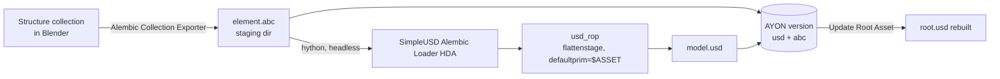

# Blender model publish: SimpleUSD Model (via Houdini)

This creator publishes a Blender collection as the same `model` product the Houdini [SimpleUSD Asset (Model)](houdini.md#simpleusd-asset) creator makes, so the artist never has to open Houdini. Blender exports the collection as Alembic. A headless `hython` then converts it to USD with the **SimpleUSD Alembic Loader** HDA, and Blender integrates the result.

## Requirements

- Blender **4.2+**, which added Collection Exporters.
- A Houdini installation configured in AYON's Applications settings, and a license that can run `hython`.
- The collection must follow the SimpleUSD Alembic Loader's structure, using empties in Blender:

  ```
  <element>
  └── geo
      ├── render
      │   └── meshes...
      ├── proxy
      │   └── meshes...
      └── guide
          └── meshes...
  ```

## Artist usage

1. In the Outliner, select the **structure collection**. Select exactly one collection.
2. *Publisher > Create > **SimpleUSD Model***.
   - The collection is linked into the new instance collection.
   - If it doesn't have an **Alembic Collection Exporter** yet, one is added with default settings (*Collection Properties > Exporters*).
3. Optionally, adjust that exporter's settings. They're used for the publish; only the output file path is redirected to the publish staging folder.
4. Publish.

| Option | Default | Effect |
| --- | --- | --- |
| **Update Root Asset** | on | Rebuild the asset's [root file](root-asset.md) after publishing, exactly like a Houdini publish |

The creator turns off ayon-blender's own model extractors and some validators on the instance. You can turn them back on in the Publisher:

- *Extract Blend*, *Extract FBX*, *Extract Model USD*, *Extract Model ABC*
- *Validate Transform Zero*: the structure empties carry transforms.
- *Validate Model Mesh UV Map1*: UV map names don't matter for USD.
- *Integrate Hero Version*

## How it works



| Order | Plugin | What it does |
| --- | --- | --- |
| Validator | [`ValidateSimpleUSDCollectionExporter`](../client/ayon_simpleusd/plugins/publish/blender/validate_simpleusd_collection_exporter.py) | The instance holds exactly one collection, and that collection has an Alembic Collection Exporter. **Repair** adds one. |
| Extractor | [`ExtractSimpleUSDCollectionAbc`](../client/ayon_simpleusd/plugins/publish/blender/extract_simpleusd_collection_abc.py) | Runs the collection's exporter into the staging dir and adds the `abc` representation |
| Extractor + 0.1 | [`ExtractSimpleUSDHoudiniUsd`](../client/ayon_simpleusd/plugins/publish/blender/extract_simpleusd_houdini_usd.py) | Converts the Alembic to USD in headless Houdini and adds the `usd` representation |

### The Houdini conversion

[`houdini_conversion.py`](../client/ayon_simpleusd/houdini_conversion.py) launches `hython` with [`scripts/hython_abc_to_usd.py`](../client/ayon_simpleusd/scripts/hython_abc_to_usd.py):

1. **Finding Houdini.** It uses the variant set in *Settings > Simple USD > Blender Model (via Houdini) > Houdini Application* (for example `houdini/21-0`). If that's empty, it uses the latest variant whose executable exists. `hython` is taken from the same `bin` folder.
2. **Environment.** It builds the same AYON environment a farm render of that Houdini variant would get (launch type `farm_render`). The Simple USD prelaunch hooks therefore run: the HDAs go on `HOUDINI_PATH` and `$ASSET` is set. Before that, it strips Blender's own variables (`BLENDER_*`, ayon-blender's scripts, Blender's Python on `PYTHONPATH`). Otherwise Houdini would import Blender's `pxr` and fail with a DLL error.
3. **Conversion.** In `/stage`, the script creates:
   - the newest installed `SimpleUSD_Alembic_Loader` pointing at the `.abc`, and
   - a `usd_rop` with the same settings as the Houdini creator: `flattenstage`, `defaultprim = $ASSET`, no relative paths.

   It then renders the `usd_rop`.
4. **Errors.** On any failure, the script saves the scene as `<product>_conversion.hipnc` in the staging dir and exits with an error.

### Troubleshooting

If the conversion fails, the Publisher shows a **"Houdini conversion failed"** error. Its details contain:

- the last 40 lines of the hython log, and
- the path of the debug `.hipnc`. Open it in Houdini to inspect the Alembic Loader.

| Symptom | Likely cause |
| --- | --- |
| `No Houdini application with an existing executable…` | No Houdini variant installed or configured, or the configured *Houdini Application* name is wrong |
| `HDA 'LennartHaak::SimpleUSD_Alembic_Loader' is not installed` | The Simple USD startup folder isn't on `HOUDINI_PATH` |
| `Houdini's USD Python modules failed to import…` | Another app's `pxr` is on `PYTHONPATH` |
| `$ASSET is not set` | The publish context has no folder |
| `Houdini conversion timed out after …s` | Raise *Timeout* in the settings (default 600 s) |
