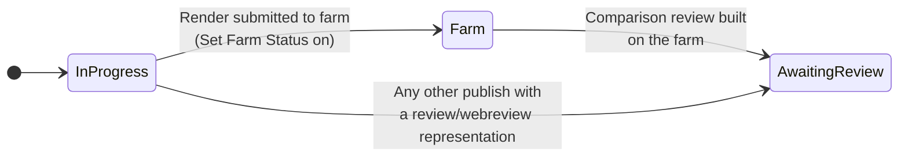

# Rendering & review

This page covers what happens when you publish a [Simple USD Render](houdini.md#simple-usd-render):

- where the USD export and frames are written,
- how all render variants are combined into one comparison review video on the farm, and
- how the AYON task status follows the render. ShotGrid mirrors that status through AYON's sync.

## Versioned render folder

[`collect_simpleusd_render_paths.py`](../client/ayon_simpleusd/plugins/publish/houdini/collect_simpleusd_render_paths.py) runs once AYON has resolved the publish version (Collector + 0.9). It redirects the USD export and the frames into one shared folder per version:

```
$HIP/render/v###/<sequence>_<shot>_render_<variant>_v###.usd
$HIP/render/v###/<sequence>_<shot>_render_<variant>_v###.$F4.<ext>
```

So every variant of a version renders into the same folder, with file names that don't overlap.

To find the image outputs, the collector walks the network above the render ROP and renames each output it finds:

| Node | Parm renamed |
| --- | --- |
| Karma Render Settings (`karmarendersettings`) | `picture` |
| Render Product (`renderproduct`) | `productName` |
| Karma Render Products (`karmarenderproducts`) | every `productName_N`. With several products, the product's prim name is added as a suffix. |

The file extension is taken from the existing output path, and defaults to `exr`.

## Comparison review

All *Simple USD Render* variants of one publish that render on the farm with **Create Reviewable** on are combined into a single side-by-side video. It's uploaded to AYON as a reviewable, and ShotGrid syncs it from there.

For example, three variants are laid out in a 2×2 grid:

```
┌──────────────┬──────────────┐
│     Main     │ KeyLightWarm │
├──────────────┼──────────────┤
│ KeyLightCool │              │
└──────────────┴──────────────┘
```

Each tile shows its variant name at the top. The date, version, artist, sequence/shot and frame counter are burned into the corners of the whole video.

### How it works

**1. Collecting the metadata (in Houdini).** [`collect_simpleusd_comparison_metadata.py`](../client/ayon_simpleusd/plugins/publish/houdini/collect_simpleusd_comparison_metadata.py) gathers every included variant's name, base file name, render folder, extension and frame range. It also gathers the shot resolution (from the task or folder; 1920×1080 if unset), the fps, the sequence and shot, and the version. An identical copy of this list goes onto every render instance, so it travels inside each variant's own farm publish job.

**2. Building on the farm.** [`build_simpleusd_comparison_review.py`](../client/ayon_simpleusd/plugins/publish/global/build_simpleusd_comparison_review.py) runs in every variant's farm publish job (pyblish target `farm`). Each variant renders and publishes as its own job, and AYON *moves* a variant's frames out of the render folder as soon as that variant's publish finishes. To handle any job order, each pass does this:

1. If `.comparison_<version>.lock` already exists in the render folder, it skips.
2. It copies its own frames, which are still present, into `render/v###/.comparison_cache/<variant>/`.
3. If any variant's frames are still missing from the cache, it skips. A later pass will finish the job.
4. Otherwise, it creates the lock file atomically, so only one job builds the video.
5. It builds the video with ffmpeg:
   - Tiles go in a grid of ⌈√n⌉ columns, scaled and padded to fit the shot resolution.
   - Each tile shows its variant name.
   - The whole frame shows the date, version, artist, sequence/shot and the live frame number with the range.
   - Color: the ACEScg frames are converted with a fixed ACEScg→Rec.709 matrix, a Hable tone map and an sRGB curve. This approximates Houdini's default *ACES 1.0 SDR* viewport look, because OCIO tools aren't available on the farm. If ffmpeg lacks the `zscale`/`tonemap` filters, the frames are used without conversion.
   - Output: H.264 `<sequence>_<shot>_comparison_v###.mp4` in the render folder.
6. It attaches the mp4 as a `webreview`-tagged representation (*Comparison Review*) to the variant instance in this job. It also appends `Rendered variants: … Published by …` to that version's comment. AYON's `IntegrateAYONReview` then uploads it as a reviewable.
7. It sets the task to the [review status](#task-status-automation) and deletes `.comparison_cache`.

If anything fails, the publish itself still succeeds. The lock and any partial mp4 are removed so a later pass can retry, and the cache is kept for that retry.

> [!NOTE]
> The burn-in font is hard-coded to `C:/Windows/Fonts/arial.ttf`, so the
> farm publish job must run on Windows.

## Task status automation

Simple USD sets AYON task statuses at a few points. AYON's own ShotGrid sync mirrors them out.



| Plugin | When | Status (setting) |
| --- | --- | --- |
| [`IntegrateSimpleUSDFarmStatus`](../client/ayon_simpleusd/plugins/publish/global/integrate_simpleusd_farm_status.py) | After a Simple USD Render was successfully submitted to the farm. It runs after ayon-royalrender's submit step, so a failed submission stops the publish first. | *Farm Status > Status Name* (`farm`) |
| `BuildSimpleUSDComparisonReview` | When the comparison video has been built and attached on the farm | *AYON Review Status > Status Name* (`Aw. Review`) |
| [`IntegrateSimpleUSDAyonReviewStatus`](../client/ayon_simpleusd/plugins/publish/global/integrate_simpleusd_ayon_review_status.py) | After any local publish that integrated a `review` or `webreview` representation (for example an OpenGL/flipbook review) | *AYON Review Status > Status Name* (`Aw. Review`) |

Rules that keep these from overwriting each other:

- The generic review-status plugin **never** handles `usdrenderPackage` instances, and it only runs locally (target `local`). Render status is owned by the farm-status plugin and the comparison builder.
- `workfile` publishes only set the review status if *Apply To Workfile Publishes* is on (off by default). The workfile publishes in the same batch as a farm submission and would otherwise overwrite the farm status.
- Status names must match a status in the project's anatomy exactly (*Project Settings > Anatomy > Statuses*). An empty name turns that update off.

See [Settings](settings.md) for all options.
