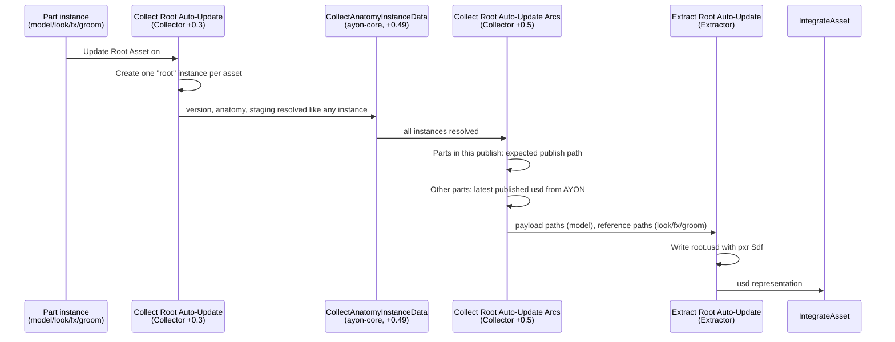

# Root asset

Each asset has one **root** USD file (product type `root`) that composes all of its parts:

- the latest `model` as a **payload**, and
- the latest `look`, `fx` and `groom` layers as **references**.

Shots load the root with [Reference Root USD](loaders.md#reference-root-usd), so they always get the full asset.

You don't publish the root by hand. Whenever a part is published with **Update Root Asset** on (the default), Simple USD publishes a new root version in the same publish. This works from both Houdini and Blender.

## Artist usage

- Leave **Update Root Asset** on when publishing with [SimpleUSD Asset](houdini.md#simpleusd-asset) or the [Blender model creator](blender-model.md).
- Turn it off for a publish that shouldn't reach shots yet. The root then keeps pointing to the previous version. The part's version comment notes that the update was disabled.
- The first auto-update creates the root product if the asset doesn't have one yet.
- A manual root publish is still possible: choose *Asset Type: Root Asset* in the Houdini creator. It versions up the same root product.

## Settings

*Settings > Simple USD > Root Asset*

| Setting | Default | Meaning |
| --- | --- | --- |
| Task Name | `root` | The task the root is always published under, whatever task the part came from. The asset needs a task with this name. |
| Default Variant | `Main` | Variant used when the root product is created for the first time. Later updates reuse the existing product name. |

## How it works



### 1. Creating the root instance

[`collect_simpleusd_root_auto_update.py`](../client/ayon_simpleusd/plugins/publish/global/collect_simpleusd_root_auto_update.py), `CollectSimpleUSDRootAutoUpdateInstance`:

- **What triggers it.** An instance triggers an update when all of these are true:
  - It's active.
  - Its product type is `model`, `look`, `fx` or `groom`.
  - It was made by the Houdini SimpleUSD Asset creator or the Blender SimpleUSD Model creator. Shot `fx` from the SimpleUSD Shot creator never triggers it.
  - *Update Root Asset* is on.
- **Grouping.** Triggers are grouped by asset, so several parts published together produce one root version.
- **Product name.** If the asset already has a `root` product, its name is reused, so there is never a second, parallel root. If there are several, the first one is used and a warning is logged. Otherwise, a name is generated from the *Default Variant*.
- **The instance.** It's a plain publish instance without a Houdini node: task = *Task Name*, families `root` and `simpleusdAutoRoot`, group `SimpleUSD Layers`. It always versions up from its own last version, not the workfile version, and it skips the hero version.

### 2. Resolving the contributions

`CollectSimpleUSDRootAutoUpdateArcs` runs after AYON has resolved versions and paths for every instance.

1. **Parts in the current publish** take priority. Their final publish path is known in advance (`get_instance_expected_output_path`), so the root can point to versions that are being integrated in the same publish.
2. **All other parts** already on the server are queried from AYON. For each product, the latest version's `usd` representation is used.

Model paths become **payloads**, and everything else becomes **references**.

### 3. Writing the file

[`extract_simpleusd_root_auto_update.py`](../client/ayon_simpleusd/plugins/publish/global/extract_simpleusd_root_auto_update.py) writes the layer directly with the `pxr` Sdf API. It doesn't create or cook a Houdini node, which is why it also works from Blender.

- It writes one `Xform` prim `/<asset>`, set as the default prim, with the payloads and references prepended.
- **Typeless prim fix.** Grouping prims (such as a look file's `/lookdev/mat`) can end up without a type in a part's flattened file. Any prim without a type in the composed result gets an explicit `Scope` type authored in the root layer.
- It's saved as a binary crate file `<product>.usd`, the `usd` representation.

If no part can be resolved, an empty root prim is written and a warning is logged.

## Version comments

[`collect_simpleusd_version_comment.py`](../client/ayon_simpleusd/plugins/publish/global/collect_simpleusd_version_comment.py) adds a short note after the artist's own comment in the AYON version comment. AYON's ShotGrid sync runs on the server from AYON entities, so this is how the information reaches the ShotGrid Version.

Example on a part:

```
Fixed the handle.
Published model 'modelMain' v004. Merged into root 'rootMain' v012. Published by Jane Doe.
```

Example on the root:

```
Root asset updated to v012. Includes: model 'modelMain' v004 (payload); look 'lookMain' v007 (reference). Triggered by: modelMain. Published by Jane Doe.
```

If a part's root update was off, the note says "Root Asset update was disabled for this publish." instead of the merge line. The publisher name is the AYON user's full name, or the username if no full name is set.
